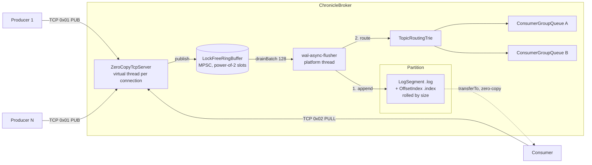

# ChronoLog

> A high-throughput, low-level streaming storage engine and message broker built from scratch in **Java 21**, with no runtime dependencies.

ChronicleQueue combines the storage design of a Kafka-style commit log with the routing model of an AMQP broker such as RabbitMQ. Producers publish events over a custom binary TCP protocol. Events pass through a lock-free ring buffer, are persisted to a segmented append-only write-ahead log (WAL), and are routed to named consumer groups through a topic-routing trie. Consumers can pull raw log bytes straight from the OS page cache using zero-copy `FileChannel.transferTo()`.

The project is meant as a deep dive into the "mechanical sympathy" techniques behind modern messaging systems: sequential I/O, memory-mapped sparse indexes, cache-line padding, CAS-based concurrency, memory-ordering fences, virtual threads and kernel `sendfile`.

---

## Table of Contents

1. [Feature Overview](#feature-overview)
2. [Architecture](#architecture)
3. [Project Structure](#project-structure)
4. [Getting Started](#getting-started)
5. [Wire Protocol](#wire-protocol)
6. [Deep Dive: Storage Layer](#deep-dive-storage-layer)
7. [Deep Dive: Concurrency Layer](#deep-dive-concurrency-layer)
8. [Deep Dive: Routing Layer](#deep-dive-routing-layer)
9. [Deep Dive: Broker & Network Layer](#deep-dive-broker--network-layer)
10. [Class Reference](#class-reference)
11. [Configuration](#configuration)
12. [Testing](#testing)
13. [Known Limitations & Roadmap](#known-limitations--roadmap)
14. [Tech Stack](#tech-stack)

---

## Feature Overview

| Capability | Implementation |
|---|---|
| Durable storage | Append-only WAL split into fixed-size segment files (`.log`) |
| Data integrity | Every record is framed with a magic byte, a CRC32 checksum and a length prefix |
| Fast random reads | Sparse offset index (`.index`), memory-mapped (`MappedByteBuffer`), searched by binary search |
| Segment management | Automatic rollover when a segment reaches its size limit; segment lookup through `ConcurrentSkipListMap.floorEntry()` |
| Ingestion | Lock-free multi-producer single-consumer (MPSC) ring buffer modeled on the LMAX Disruptor |
| CPU cache efficiency | 64-byte padded sequence counters to avoid false sharing |
| Memory ordering | `VarHandle` acquire/release/opaque semantics instead of heavyweight `volatile` or locks |
| Routing | AMQP-style `DIRECT`, `FANOUT` and `TOPIC` exchanges with `*` and `#` wildcards, implemented with a trie |
| Consumer groups | Bounded per-group in-memory queues |
| Networking | Custom binary TCP protocol served by Java 21 **virtual threads** |
| Zero-copy reads | `FileChannel.transferTo()` sends log bytes to a socket (kernel `sendfile`) without copying them into the JVM heap |
| Shutdown | Shutdown hook drains the ring buffer, `fsync`s and closes the WAL |

---

## Architecture



### Write path

1. A producer sends a `PUB` frame over TCP. A virtual thread parses it and calls `ChronicleBroker.publish(routingKey, payload)`.
2. `LockFreeRingBuffer.publish()` claims the next sequence with a CAS loop, writes the event into the pre-allocated slot, and publishes it with a `setRelease` store. The producer gets the sequence number back immediately and the TCP server returns it as an 8-byte acknowledgement.
3. A single dedicated thread, `wal-async-flusher`, drains up to 128 committed events per batch. For each event it:
   - appends the payload to the `Partition`, which frames it, writes it to the active `LogSegment` and updates the sparse index when due, then
   - routes the event through the `TopicRoutingTrie` into the queues of every matching consumer group.

### Read path

- **Zero-copy pull (network):** a `PULL` frame names an offset and a byte budget. The broker finds the segment, uses the sparse index to find a physical position and calls `FileChannel.transferTo()` directly into the client `SocketChannel`.
- **Point read (in-process):** `ChronicleBroker.readAtOffset(offset)` locates the segment, binary-searches the mmap index for the closest earlier indexed position, then scans forward frame by frame to the exact record.
- **Consumer-group queues (in-process):** `getConsumerQueue(groupId).poll(timeoutMs)` returns routed events.

---

## Project Structure

```
ChronicleQueue/
├── pom.xml                      # Maven build (Java 21, JUnit 5.10.2, Surefire 3.2.5)
├── mvnw / mvnw.cmd              # Maven Wrapper scripts (Maven 3.9.11)
├── .mvn/wrapper/                # Wrapper configuration
├── .gitignore                   # Ignores target/, IDE files, *.log, *.index, data dirs
└── src/
    ├── main/java/org/zeromesa/
    │   ├── ChronicleApp.java            # Entry point: starts broker + TCP server
    │   ├── LiveSmokeClient.java         # Demo client: publish, benchmark, zero-copy pull
    │   ├── broker/
    │   │   └── ChronicleBroker.java     # Orchestrates ring buffer, WAL, router
    │   ├── concurrency/
    │   │   ├── LockFreeRingBuffer.java  # MPSC ring buffer (Disruptor-style)
    │   │   ├── PaddedSequence.java      # Cache-line padded atomic cursor
    │   │   └── RingBufferSlot.java      # Reusable event holder
    │   ├── network/
    │   │   └── ZeroCopyTcpServer.java   # Binary TCP server on virtual threads
    │   ├── routing/
    │   │   ├── ExchangeType.java        # DIRECT | FANOUT | TOPIC
    │   │   ├── TopicRoutingTrie.java    # Binding store + wildcard matcher
    │   │   └── ConsumerGroupQueue.java  # Bounded blocking queue per group
    │   └── storage/
    │       ├── Record.java              # Frame format + CRC32 (de)serialization
    │       ├── CorruptRecordException.java
    │       ├── LogSegment.java          # One .log file
    │       ├── IndexEntry.java          # 12-byte index entry definition
    │       ├── OffsetIndex.java         # mmap sparse index (.index)
    │       └── Partition.java           # Ordered chain of segments + indexes
    └── test/java/org/zeromesa/
        ├── broker/ChronicleEndToEndTest.java
        ├── concurrency/LockFreeRingBufferTest.java
        └── storage/{LogSegmentTest, OffsetIndexTest, PartitionTest}.java
```

---

## Getting Started

### Prerequisites

- **JDK 21 or newer.** Virtual threads, `Thread.ofPlatform()` and pattern-style `switch` are used.
- No Maven install is needed; the Maven Wrapper downloads Maven 3.9.11 on first run.

### Build and test

```bash
git clone https://github.com/EclipseZoro/ChronicleQueue.git
cd ChronicleQueue

./mvnw clean test       # Linux / macOS
mvnw.cmd clean test     # Windows
```

### Run the broker

```bash
./mvnw -q compile
java -cp target/classes org.zeromesa.ChronicleApp
```

Expected banner:

```
=========================================================
 ChronicleQueue Engine RUNNING on TCP port 9092
 Storage Directory : <cwd>/chronicle-data
 Ring Buffer Slots : 4096 (Lock-Free MPSC)
 Segment Rollover  : 1024 KB
=========================================================
```

On startup the app pre-registers three consumer groups:

| Group | Exchange | Pattern |
|---|---|---|
| `billing-service` | TOPIC | `orders.*.success` |
| `order-analytics` | TOPIC | `orders.#` |
| `global-audit-log` | FANOUT | *(none, receives everything)* |

Press **Ctrl+C** for a graceful shutdown: the TCP server closes, the ring buffer is drained, and the WAL is `fsync`ed and closed.

### Run the smoke client

With the broker running, in a second terminal:

```bash
java -cp target/classes org.zeromesa.LiveSmokeClient
```

It will:

1. Publish three sample events (`orders.india.success`, `orders.us.failed`, `payments.upi.settled`).
2. Blast 50,000 events over a single TCP connection and print the measured ingestion rate. Each publish waits for its 8-byte ack, so this is a synchronous round-trip benchmark.
3. Issue a zero-copy `PULL` from offset 0 (up to 2 KB) and decode and print the first records.

### Use it as a library

```java
try (ChronicleBroker broker = new ChronicleBroker(
        new File("data"),
        4096,          // ring buffer slots (power of 2)
        1024 * 1024,   // max bytes per segment
        512)) {        // sparse index interval in bytes

    broker.bindConsumerGroup(ExchangeType.TOPIC, "orders.*.success", "billing");

    long seq = broker.publish("orders.us.success", "paid".getBytes());

    ConsumerGroupQueue q = broker.getConsumerQueue("billing");
    ConsumerGroupQueue.RoutedEvent ev = q.poll(500); // blocks up to 500 ms

    Record r = broker.readAtOffset(0);               // point read from the WAL
}
```

---

## Wire Protocol

All integers are big-endian (the Java `ByteBuffer` default). The server keeps a connection open and processes commands in sequence until the client disconnects.

### `0x01` PUB: publish an event

```
Request:  [0x01][keyLen:int32][keyBytes:UTF-8][payloadLen:int32][payloadBytes]
Response: [sequence:int64]
```

The 8-byte response is the ring-buffer sequence assigned to the event. It is returned as soon as the event is claimed in memory, **before** it is written to disk. Because there is one partition and one flusher thread, the sequence equals the partition offset the event will receive.

### `0x02` PULL: zero-copy fetch

```
Request:  [0x02][offset:int64][maxBytes:int64]
Response: raw log frames, streamed straight from the page cache (no envelope or length header)
```

The response is a byte stream of on-disk frames (see below). The client decodes them itself, as `LiveSmokeClient` does with `Record.deserialize()`.

### On-disk record frame

```
 0        1            5            9
 +--------+------------+------------+----------------------+
 | magic  | CRC32      | length     | payload              |
 | 0xBF   | int32      | int32      | `length` bytes       |
 +--------+------------+------------+----------------------+
        9-byte header (Record.HEADER_SIZE)
```

- **Magic byte `0xBF`** detects misaligned reads and garbage data.
- **CRC32** is computed over the payload only.
- **Length** makes the frame self-delimiting.
- The logical offset is **not stored** in the frame. It is implicit from position order within the partition.

---

## Deep Dive: Storage Layer

Package: `org.zeromesa.storage`

### `Record`

A Java `record(long offset, byte[] payload)` that also holds the framing logic.

- `serialize(byte[])` allocates a `ByteBuffer` of `9 + payload.length`, writes magic, CRC32, length and payload, then flips it for writing.
- `deserialize(ByteBuffer)` validates the magic byte, reads the checksum and length, copies out the payload and recomputes the CRC32. It throws `CorruptRecordException` on any mismatch.

### `LogSegment`: one `.log` file

- Files are named with a 20-digit zero-padded base offset, e.g. `00000000000000000000.log`, so they sort lexicographically in offset order.
- Opened through `RandomAccessFile("rw")` and accessed via `FileChannel` with positional writes and reads (`channel.write(buf, position)`), so there is no shared seek pointer.
- `append(byte[])` is `synchronized`. It frames the payload, and if `currentPosition + frameSize > maxSegmentBytes` it returns **`-1`**, the signal for rollover. Otherwise it writes the frame at the tail and returns the frame's physical position.
- `read(position)` reads the header, then the payload, and verifies magic and CRC32.
- `readFrame(position)` is the scanner variant. It returns a `RawFrame(payload, frameSizeBytes)`, or `null` at the end of the file or on a short read, so callers can walk frame to frame.
- `transferTo(position, maxBytes, target)` caps the transfer at the bytes actually written and delegates to `FileChannel.transferTo()`, which uses `sendfile` on Linux and `TransmitFile` on Windows.
- `close()` calls `channel.force(true)` to flush dirty pages to disk, then closes the channel.
- On reopen, the write position starts at the existing file size.

### `IndexEntry` and `OffsetIndex`: the sparse mmap index

Each entry is 12 bytes: `int relativeOffset` (4 bytes) plus `long physicalPosition` (8 bytes).

- The index is **sparse**. It does not index every record, only about one per `indexIntervalBytes` of log data. This keeps the index small enough to stay hot in memory.
- The file is pre-sized to `maxEntries × 12` bytes and mapped once with `FileChannel.map(READ_WRITE, ...)`. Reads and writes are plain memory accesses through the `MappedByteBuffer`, with no per-lookup syscalls.
- `append(relativeOffset, physicalPosition)` writes at the next slot and throws `IllegalStateException` if the index is full.
- `lookup(targetOffset)` is a binary search over the mapped bytes and returns the **floor** entry: the physical position of the largest indexed offset that is `<= target`. An exact hit returns immediately. If the target is below the first entry it returns `0`.
- When opening a non-empty existing file, the constructor recovers the entry count by scanning for the first unwritten (all-zero) slot.
- `close()` calls `mappedBuffer.force()` before closing the channel.

### `Partition`: the segment manager

A `Partition` is the ordered set of segments making up one log.

- `ConcurrentSkipListMap<Long, SegmentBundle>` maps each segment's base offset to a bundle of `(LogSegment, OffsetIndex, bytesSinceLastIndex)`. `floorEntry(offset)` finds the owning segment in O(log S).
- `nextOffset` is an `AtomicLong` that serves as the logical offset counter and the **high watermark**.
- `maxIndexEntries = max(16, maxSegmentBytes / indexIntervalBytes + 16)`.

**`append(payload)`** (synchronized)

1. Assign `assignedOffset = nextOffset`.
2. Append to the active segment. If it returns `-1`, roll over: create a new `.log`/`.index` pair named after `assignedOffset`, make it the active segment, and retry. If the record still doesn't fit, throw `IllegalArgumentException("Single record exceeds maxSegmentSizeBytes")`.
3. Add the frame size to `bytesSinceLastIndex`. When it reaches `indexIntervalBytes`, write an index entry `(offset - baseOffset, physicalPos)` and reset the counter. The counter starts at `indexIntervalBytes`, so the very first record of every segment is always indexed.
4. Increment `nextOffset` and return the assigned offset.

**`read(targetOffset)`** resolves an exact record in three steps:

1. **O(log S):** `floorEntry` on the skip list picks the segment.
2. **O(log I):** binary search of the mmap index finds the closest indexed position at or before the target. A second binary search over physical positions recovers the matching logical offset.
3. **Forward scan:** read frames sequentially with `readFrame()` from that position, incrementing the logical offset, until it equals the target. The work is bounded by the index interval.

`read` returns `null` if the offset is negative, at or past the high watermark, or the scan hits the end of the file.

**`transferZeroCopy(offset, maxBytes, target)`** locates the segment and the floor physical position from the index, then calls `LogSegment.transferTo()`.

**On-disk layout** (default 1 MB segments):

```
chronicle-data/
├── 00000000000000000000.log      # offsets 0 .. N-1
├── 00000000000000000000.index
├── 00000000000000004821.log      # next segment, named by its first offset
├── 00000000000000004821.index
└── ...
```

---

## Deep Dive: Concurrency Layer

Package: `org.zeromesa.concurrency`

### `LockFreeRingBuffer`

A multi-producer, single-consumer ring buffer inspired by the LMAX Disruptor.

**Structure**
- The buffer size must be a positive power of two, enforced in the constructor. This lets the slot index be computed as `sequence & (size - 1)` instead of a modulo.
- Slots are pre-allocated once, so publishing does not allocate slot objects.
- `committedSequences` is a `long[]` that records, per slot, the highest sequence number whose payload has been fully written. It is accessed through an array-element `VarHandle`.
- Two cursors: `producerClaimCursor` (the next sequence to hand out) and `consumerCursor` (the last sequence the consumer has finished).

**`publish(routingKey, payload)`**

1. **Claim.** A CAS loop on the producer cursor claims `current + 1`. Before the CAS, a backpressure check computes `wrapPoint = next - bufferSize` and, while `wrapPoint > consumerCursor`, parks the thread for 1 µs with `LockSupport.parkNanos`. This stops producers from lapping the consumer.
2. **Write.** The winner has exclusive ownership of that slot and writes the routing key and payload into it.
3. **Publish.** `setRelease` stores the sequence into `committedSequences[slot]`. The release fence guarantees the payload writes are visible before the consumer can observe the commit marker.

Because several producers may claim sequences and finish out of order, the consumer cannot simply trust the producer cursor. It checks the per-slot committed sequence instead.

**`drainBatch(maxBatchSize, handler)`**

- The consumer reads `committedSequences[slot]` with `getAcquire` and processes events only while it equals the next expected sequence. It stops at the first gap, which preserves strict ordering.
- After each event it calls `slot.clear()` to release references for GC.
- After the batch it advances `consumerCursor` with a single `setRelease`, freeing slots for producers.

### `PaddedSequence`

A `long` cursor with 7 padding longs on each side so it occupies its own 64-byte cache line, avoiding **false sharing** between the producer and consumer cursors being updated on different cores. It exposes only the memory-ordering operations the ring buffer needs: `getAcquire`, `getOpaque`, `setRelease` and `compareAndSet`, all via a `VarHandle`.

### `RingBufferSlot`

A mutable holder for `routingKey`, `payload` and `assignedOffset`, reused across the buffer's lifetime.

---

## Deep Dive: Routing Layer

Package: `org.zeromesa.routing`

### `ExchangeType`

| Type | Behavior |
|---|---|
| `DIRECT` | Delivers when the routing key equals the bound pattern exactly |
| `FANOUT` | Delivers to every bound group regardless of key |
| `TOPIC` | Delivers when the routing key matches a dotted pattern with wildcards |

### Topic wildcards

Routing keys are dot-separated words, e.g. `orders.india.success`.

| Token | Meaning |
|---|---|
| `*` | Exactly one word |
| `#` | Zero or more words |

| Pattern | `orders.us.success` | `orders.us.failed` | `orders` | `payments.upi.settled` |
|---|:-:|:-:|:-:|:-:|
| `orders.*.success` | yes | no | no | no |
| `orders.#` | yes | yes | yes | no |
| `#` | yes | yes | yes | yes |

### `TopicRoutingTrie`

- **TOPIC bindings** are stored in a trie keyed by pattern tokens. `bind()` splits the pattern on `.` and walks or creates nodes, recording the group at the last node. Writes take a `ReentrantReadWriteLock` write lock.
- **FANOUT bindings** go in a `CopyOnWriteArraySet`.
- **DIRECT bindings** go in a `ConcurrentHashMap<pattern, Set<groupId>>`.
- `route(offset, routingKey, payload)` builds the set of matching groups:
  1. all fanout groups,
  2. direct matches by exact key,
  3. topic matches via a recursive `searchTrie` under the read lock, which tries an exact token child, a `*` child, and a `#` child consuming one or more words (plus `#` matching zero words at the end).
  
  It then wraps the event in a `RoutedEvent(offset, routingKey, payload)` and offers it to each matched group's queue, and returns the matched group IDs.
- `bind()` auto-registers the group with a queue capacity of **10,000**.

### `ConsumerGroupQueue`

A thin wrapper over a bounded `LinkedBlockingQueue<RoutedEvent>`, with `offer()` (non-blocking), `poll(timeoutMs)`, `size()` and `getGroupId()`.

---

## Deep Dive: Broker & Network Layer

### `ChronicleBroker`

The facade that wires the components together. Its constructor creates the ring buffer, the `Partition` and the router, then starts the `wal-async-flusher` platform thread.

| Method | Purpose |
|---|---|
| `publish(key, payload)` | Enqueue into the ring buffer and return the sequence |
| `bindConsumerGroup(type, pattern, groupId)` | Register a routing binding |
| `getConsumerQueue(groupId)` | Get a group's queue |
| `readAtOffset(offset)` | Point read from the log |
| `transferZeroCopy(offset, maxBytes, channel)` | Zero-copy stream to a channel |
| `getPersistedHighWatermark()` | Number of records durably appended to the partition |
| `close()` | Stop the flusher (waits up to 3 s for the ring buffer to drain), then close the partition |

The flush loop runs while the broker is running or while the ring buffer still has undrained events. It calls `drainBatch(128, ...)`, and for each event appends to the partition, records the assigned offset and routes. It uses `Thread.onSpinWait()` when idle.

### `ZeroCopyTcpServer`

- Uses a blocking `ServerSocketChannel` with `Executors.newVirtualThreadPerTaskExecutor()`. One virtual thread accepts connections and each client gets its own virtual thread, so thousands of idle connections are cheap.
- Reads commands in a loop. For `PUB` it parses the frame, publishes, and writes back the 8-byte sequence. For `PULL` it reads the 16-byte request and invokes `broker.transferZeroCopy(...)` directly into the client channel.
- `new ZeroCopyTcpServer(0, broker)` binds an ephemeral port, and `getPort()` reports it, which the end-to-end test relies on.

### `ChronicleApp` and `LiveSmokeClient`

`ChronicleApp` is the runnable entry point (see [Configuration](#configuration)). `LiveSmokeClient` is a hand-rolled client that doubles as a protocol reference and a rough throughput probe.

---

## Class Reference

| Class | Lines | Responsibility |
|---|---:|---|
| `ChronicleApp` | 48 | Main entry point, default bindings, shutdown hook |
| `LiveSmokeClient` | 95 | Demo and benchmark client |
| `ChronicleBroker` | 79 | Orchestration of ring buffer, WAL flusher, router |
| `ZeroCopyTcpServer` | 109 | Binary protocol server |
| `LockFreeRingBuffer` | 120 | MPSC ring buffer |
| `PaddedSequence` | 51 | Cache-line padded cursor |
| `RingBufferSlot` | 33 | Reusable event slot |
| `TopicRoutingTrie` | 114 | Exchange bindings and wildcard matching |
| `ConsumerGroupQueue` | 31 | Per-group bounded queue |
| `ExchangeType` | 6 | Exchange enum |
| `Record` | 53 | Frame format and CRC32 |
| `LogSegment` | 147 | Single log file |
| `OffsetIndex` | 120 | mmap sparse index |
| `IndexEntry` | 5 | Index entry layout |
| `Partition` | 183 | Segment chain, rollover, indexed reads |
| `CorruptRecordException` | 8 | Integrity failure signal |

---

## Configuration

Settings are currently constants in `ChronicleApp.main()`:

| Setting | Default | Meaning |
|---|---|---|
| `dataDir` | `chronicle-data` | Directory for `.log` and `.index` files |
| `port` | `9092` | TCP listen port |
| `ringBufferSize` | `4096` | Ring buffer slots (must be a power of two) |
| `maxSegmentBytes` | `1 MB` | Segment rollover threshold (kept small so rollovers are easy to observe) |
| `indexIntervalBytes` | `512` | A sparse index entry is written roughly every N bytes of log data |

Other tunables in code: flusher batch size (`128`), consumer-group queue capacity (`10,000`), flusher join timeout on close (`3 s`).

---

## Testing

Run everything with `./mvnw test` (JUnit Jupiter 5.10.2, Surefire 3.2.5). Tests use temporary directories and clean up after themselves.

| Test | What it verifies |
|---|---|
| `LogSegmentTest` | Round-trip write and read of records; returns `-1` when capacity is exceeded |
| `OffsetIndexTest` | Exact-hit and floor lookups, including offsets between and beyond indexed entries |
| `PartitionTest` | 100 records across many 500-byte segments; every offset readable across segment boundaries and between sparse index points |
| `LockFreeRingBufferTest` | 8 concurrent producers × 5,000 events; the consumer receives all 40,000 with no loss or duplication |
| `ChronicleEndToEndTest` | TCP publish, async WAL persistence, topic and fanout routing, and zero-copy pull with CRC validation, all end to end |

---

## Known Limitations & Roadmap

This is an educational engine and not production-ready. Current gaps, which are good candidates for future work:

**Durability and recovery**
- The `PUB` ack is sent when the event is claimed in the ring buffer, not after it is written or fsynced. `fsync` happens only on `close()`.
- There is no startup recovery. `Partition` always begins at offset 0 and does not scan existing segments, so restarting against a populated data directory does not restore the offset counter or the segment list.
- Retention, compaction and corrupt-tail truncation are not implemented.

**Reads**
- `PULL` starts at the nearest *indexed* position at or before the requested offset, so the stream can begin a few records earlier than requested.
- A pull does not cross segment boundaries, and `maxBytes` can cut a frame in half. The response has no length header, so clients must handle partial frames.
- Consumer-group queues are in-process only: there is no network command to consume from them, no acknowledgements and no per-group offset tracking. A full queue silently drops new events for that group.

**Scale-out**
- One partition and one flusher thread per broker; no replication, clustering or multi-topic support.
- Dynamic binding or unbinding over the network is not exposed. Bindings are set in code.

**Ideas**
- Batched and pipelined publish, async ack modes (ack on write / ack on fsync).
- Segment-recovery scan on startup and an index rebuild path.
- A consumer-group protocol with committed offsets.
- JMH benchmarks and latency histograms.
- Multiple partitions with key-based partitioning.

---

## Tech Stack

- **Language:** Java 21 (virtual threads, records, switch expressions, `VarHandle`)
- **Build:** Maven (wrapper pinned to Maven 3.9.11)
- **Tests:** JUnit Jupiter 5.10.2, Maven Surefire 3.2.5
- **Runtime dependencies:** none; only the JDK (`java.nio`, `java.util.concurrent`, `java.lang.invoke`)
